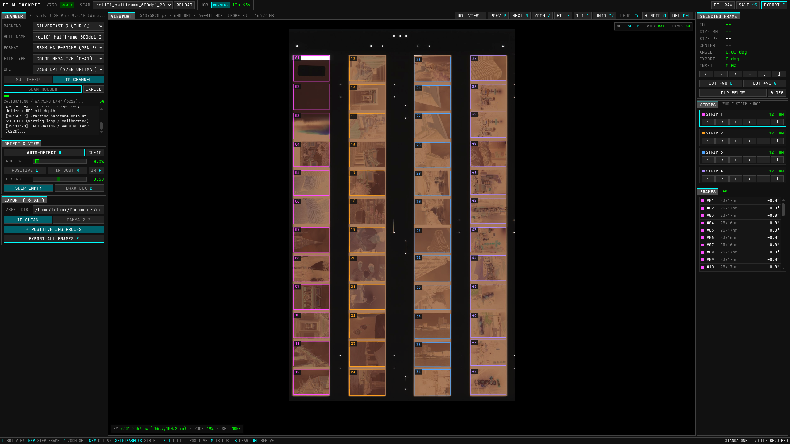

# Film Cockpit

Standalone Linux film scanning cockpit for the **Epson Perfection V700/V750 Pro** — built for fast, single-pass full-holder **35mm half-frame (48 frames)** and **35mm full-frame (24 frames)** scanning with hardware **64-bit HDRi (16-bit RGB + 16-bit IR)** dust removal, automatic border detection, and a 60fps Glass Cockpit web UI.



## Why Film Cockpit?

- **One-pass full-holder scanning:** Scans the entire 4-strip holder once at high resolution (2400–3200 DPI, 64-bit HDRi) instead of wasting time on per-frame prescans and manual marquee fiddling.
- **Zero-cost 16-bit RAW + hardware IR:** Uses **SilverFast SE Plus 9** (via [`sepgh/silverfast-linux`](https://github.com/sepgh/silverfast-linux) + Wine + `Xvfb`) in **64-bit HDRi RAW** mode for €0, and runs our native C++20 16-bit IR dust detector + harmonic inpainting at export time. Also supports **VueScan 9** as a second backend.
- **Remote-friendly web UI:** Run the server on the machine connected to the scanner and control/crop from any laptop on your LAN (`http://<host-ip>:8765`). Completely standalone — zero LLM/cloud dependencies at runtime.
- **Smart half-frame & dark-frame detection:** Combines horizontal camera-gate isolation, 2D `(pitch, phase)` periodic comb fitting (so pitch-black night shots inherit exact placement from neighbors), and tight per-frame border refinement (`~98%` area kept without bleeding into black holder bars or inter-frame rebates).
- **Open 16-bit pipeline:** Exports lossless uncompressed 16-bit RGB TIFFs (linear RAW or gamma 2.2) plus optional quick positive JPEG proofs — ready for **Darktable (`negadoctor`)**, **RawTherapee**, **LightCraft**, **Lightroom + Negative Lab Pro**, or **NLP Standalone**.

---

## Requirements (Linux x86_64)

- **Scanner:** Epson Perfection V700 / V750 Pro (`04b8:012c`, GT-X900)
- **System packages:** `g++` (C++20), `libtiff` (`libtiff-4` dev headers), `pkg-config`, `python3`, `numpy`, `Pillow`, `Xvfb`, `xdotool`, `wine`, `curl`
- **Optional:** `vuescan` (`vuescan-bin` on AUR) if you also want the VueScan backend.

### Install System Packages

**Arch / EndeavourOS:**
```bash
sudo pacman -S --needed base-devel libtiff pkgconf python python-numpy python-pillow xorg-server-xvfb xdotool wine curl
```

**Debian / Ubuntu:**
```bash
sudo apt install build-essential libtiff-dev pkg-config python3 python3-numpy python3-pillow xvfb xdotool wine curl
```

**Fedora:**
```bash
sudo dnf install gcc-c++ libtiff-devel pkgconf-pkg-config python3 python3-numpy python3-pillow xorg-x11-server-Xvfb xdotool wine curl
```

---

## Quick Setup (Fresh Linux Machine)

1. **Clone and run the bootstrap script:**
   ```bash
   git clone <your-repo-url> film_scanning
   cd film_scanning
   ./setup.sh
   ```
   `setup.sh` verifies dependencies, compiles the C++20 imaging core (`build/release/libfilm_core.so`) using [`nobcpp`](nobcpp.cpp), downloads `silverfast-linux` v0.3.0 into `./silverfast-bin/`, and installs the bundled Epson V700/V750 model definition ([`models/epson-perfection-v700-v750.json`](models/epson-perfection-v700-v750.json)). *(The V750 uses native ESC/I over USB and needs zero Epson firmware blobs or interpreter DLLs.)*

2. **One-time SilverFast 9 install (for the €0 64-bit HDRi backend):**
   Download the official SilverFast 9 Windows installer (`.exe`) from [silverfast.com](https://www.silverfast.com), then run:
   ```bash
   ./sfl.sh install /path/to/SilverFast-9.x.exe --model epson-perfection-v700-v750
   ./sfl.sh run       # Sign in to MySilverFast once, then close SilverFast
   ./sfl.sh doctor    # Verify all checks pass
   ```

3. **Start Film Cockpit:**
   ```bash
   ./start_cockpit.sh
   ```
   Open **http://127.0.0.1:8765** locally (or `http://<scanner-pc-ip>:8765` from another computer on your network).

---

## Usage & Workflow

1. **Scan Holder:** Pick `SILVERFAST 9` (default) or `VUESCAN 9`, choose format (`35MM HALF-FRAME` or `35MM FULL-FRAME`), film type, DPI (`2400` optimal / `3200` max), `IR CHANNEL` (on for C-41/E-6, auto-off for silver B&W), and click **SCAN HOLDER**.
2. **Auto-Detect & Inspect:** Auto-detect runs automatically when a scan opens (or press `D`). Press `I` for a quick optical-density positive preview, `L` to flip the viewport into landscape, and step through frames with `N`/`P` at crisp `1:1 HD` native resolution.
3. **Fine-Tune Borders:** Drag edges/corners directly on the exported box, hold `Shift` to move an entire strip together, toggle `M` to preview the hardware IR dust mask and dial in `IR SENS`, and tag any per-frame 90° export orientation with `Q`/`W`.
4. **Export 16-Bit TIFFs:** Set your target directory (local folder or mounted NAS), choose `IR CLEAN` / `GAMMA 2.2` / `+ POSITIVE JPG PROOFS`, and press `E`. Once verified, click `DEL RAW` (two-click safety confirm) to free disk space from the multi-GB master holder scan.

### Keyboard Shortcuts

| Key | Action |
|---|---|
| `L` / `Shift+L` | Rotate viewport ±90° (landscape inspection mode) |
| `N` / `P` | Step to Next / Previous frame (auto-zoomed) |
| `Z` / Double-click | Zoom selected frame to fit |
| `F` / `1` | Fit full holder / Zoom 1:1 |
| `Q` / `W` | Rotate exported frame orientation -90° / +90° |
| `Arrows` / `Shift+Arrows` | Nudge selected frame / entire strip (screen-aligned) |
| `[` / `]` | Tilt frame -0.2° / +0.2° (`Shift` for ±1.0°) |
| `I` | Toggle positive preview |
| `M` / `R` | Toggle IR dust mask overlay / raw 16-bit IR view |
| `D` / `B` / `G` | Auto-detect / Draw manual box / Stamp strip grid |
| `Del` / `Backspace` | Delete selected frame |
| `Ctrl+Z` / `Ctrl+Y` | Undo / Redo (100-step history) |
| `Ctrl+S` / `E` | Save layout JSON / Export all frames (16-bit TIFF) |

---

## Documentation & Benchmarks

- **[`docs/ENGINEERING_NOTES.md`](docs/ENGINEERING_NOTES.md):** Measured Epson V750 Pro holder geometry, 4.0 GiB classic TIFF auto-split & BigTIFF stitcher architecture, real 3200 DPI timings, 48-frame half-frame border analysis, sample exports, and 1:1 IR dust forensics (with embedded charts & visual comparisons).
- **[`docs/V2_IMAGING_PLAN.md`](docs/V2_IMAGING_PLAN.md):** Architecture roadmap for V2 grain-matched IR cleaning, YCbCr chroma/luma denoising, rebate-sampled C-41 Color Lab profiles, and the 2-tab `[ CROP | DEVELOP ]` Glass Cockpit layout.

---

## Project Layout

```text
film_scanning/
├── app/
│   ├── backends/        # Headless SilverFast 9 & VueScan 9 drivers
│   ├── core/            # C++20 libfilm_core (film_core.cpp), ctypes bridge, frame detector
│   ├── web/             # Glass Cockpit 60fps HTML5 canvas editor (zero npm/bundler)
│   └── server.py        # Zero-dependency stdlib HTTP + SSE server
├── docs/                # Engineering notes, V2 imaging plan, UI screenshot & forensic showcases
├── models/
│   └── epson-perfection-v700-v750.json   # V700/V750 hardware model for silverfast-linux
├── nobcpp.cpp / nobcpp.hpp               # Self-rebuilding C++20 build system
├── setup.sh             # One-command fresh-machine bootstrap
├── start_cockpit.sh     # Incremental C++ build + server launcher
├── sfl.sh               # Wrapper for local silverfast-linux prefix
└── scan_cli.py          # Optional headless CLI scan trigger
```
