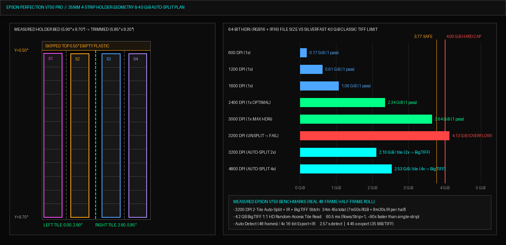
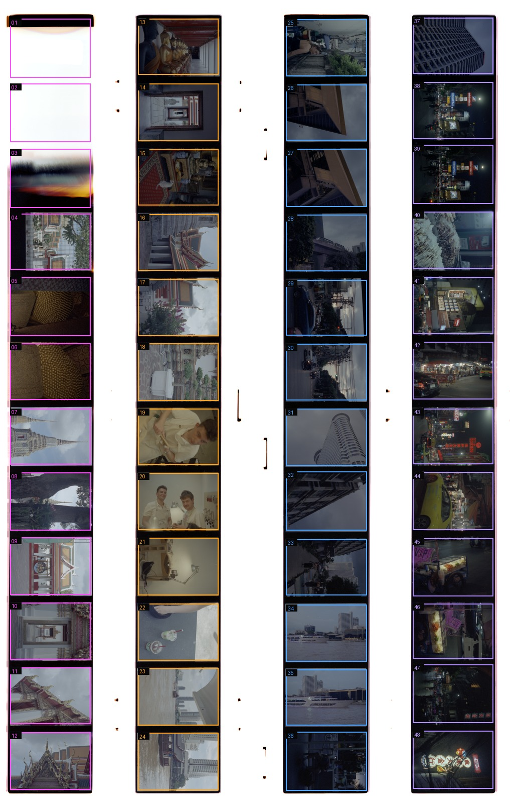
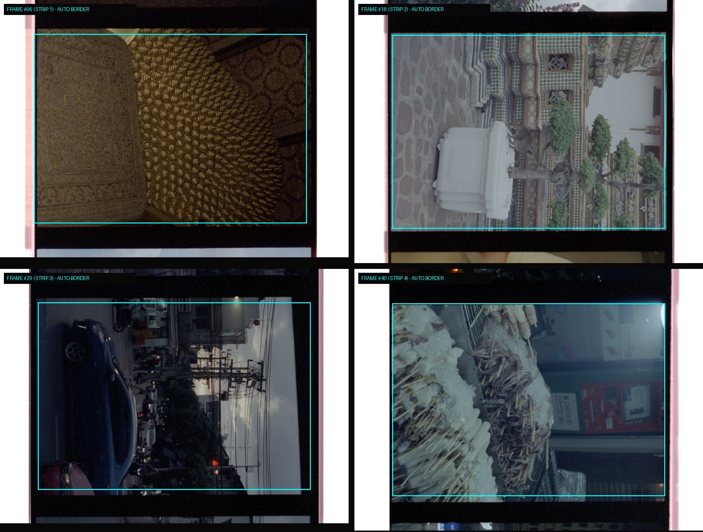
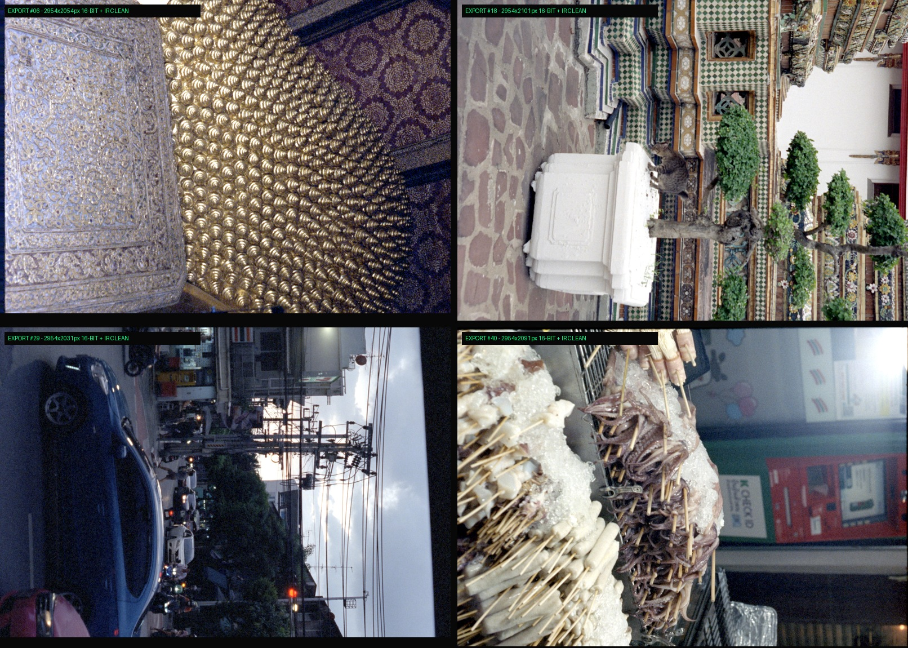
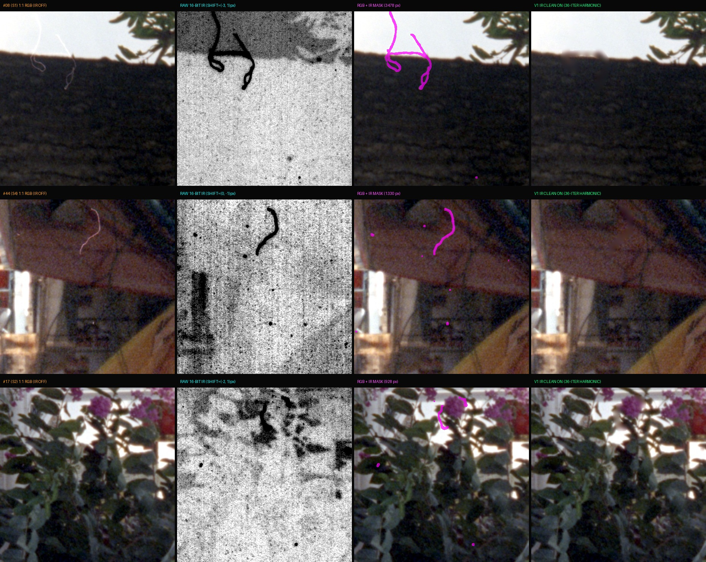
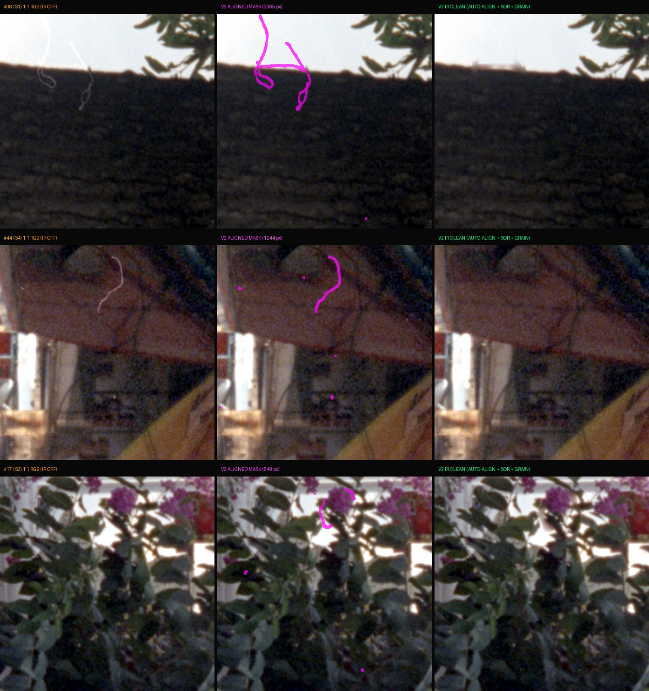
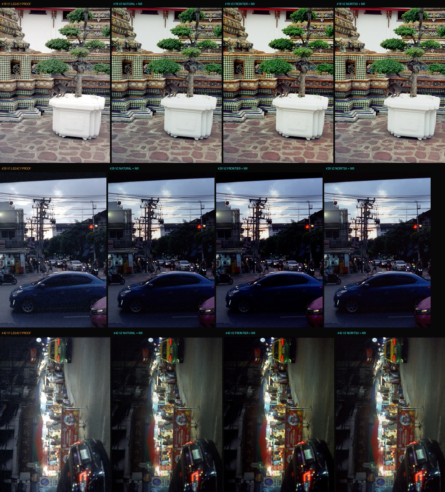
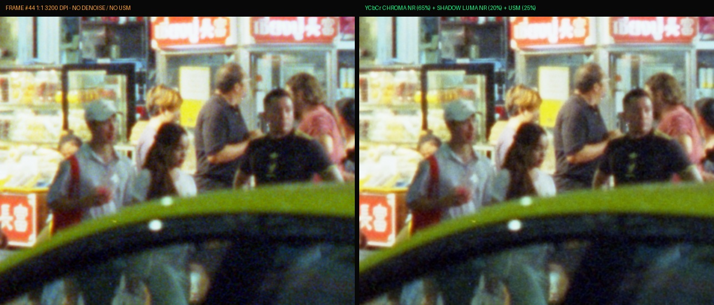

# Film Cockpit — Engineering Notes, Benchmarks & Visual Forensics

This document records the real hardware measurements, architectural discoveries, and visual benchmarks gathered while building and validating Film Cockpit on an **Epson Perfection V750 Pro (`04b8:012c`)** scanning a 48-frame **Olympus Pen FV (35mm half-frame)** C-41 color negative roll at up to **3200 DPI (64-bit HDRi = 16-bit RGB + 16-bit IR)**.

---

## 1. Epson V750 Pro + SilverFast 9 Hardware Findings

### €0 16-Bit RAW + Hardware IR Architecture
- **Epson V750 USB Protocol:** Uses native ESC/I over USB (`STI.USBSection`) — requires **zero** Epson firmware blobs and **zero** proprietary interpreter DLLs under [`sepgh/silverfast-linux`](https://github.com/sepgh/silverfast-linux). All hardware configuration lives in [`models/epson-perfection-v700-v750.json`](../models/epson-perfection-v700-v750.json).
- **64-Bit HDRi RAW:** SilverFast SE Plus 9 locks 48-bit processed iSRD behind Ai Studio, but leaves **`64 Bit HDRi RAW`** unlocked — outputting an untouched multi-page TIFF containing full 16-bit linear RGB (Directory 0) plus the raw 16-bit hardware infrared scan (Directory 1/2). Our native C++20 engine (`app/core/film_core.cpp`) runs dust masking and 16-bit inpainting directly on those raw channels for €0.

### Bypassing SilverFast's Classic 4.0 GiB TIFF Ceiling
Empirical testing at 3200 DPI proved that SilverFast 9 writes **classic 32-bit TIFF** (hard `4,294,967,295` byte limit — `TIFFAppendToStrip + Maximum TIFF file size exceeded` when appending the IR page to a 4.69 GB full-bed scan).

Measuring the physical V750 35mm 4-strip holder revealed:
- **Illuminated strips:** `X = 0.093..5.702"`, `Y = 0.651..9.587"` (the top `0.65"` of the `9.70"` bed is unused plastic).
- **Plastic divider spines:** `1.32"` (`11.8 mm` wide), **`2.90"` (`17.6 mm` wide center spine)**, and `4.48"` (`11.7 mm` wide).

Using a trimmed `5.85" × 9.20"` scan window (`+0.15"` margin outside all 4 strips) and a deterministic `3.77 GiB` (`4,050,000,000 B`) safety cap:
- **300–3000 DPI (with IR)** and **300–3200 DPI (no IR / B&W)** run in **1 single pass** (`3000 DPI + IR = 3.64 GiB`).
- **3200 DPI + IR** automatically splits into **2 tiles** along the `17.6 mm` center spine (`2.10 GiB` each — zero frames ever cross the seam) and streams them scanline-by-scanline into one seamless **64-bit BigTIFF** (`~2 MB` RAM).
- **4800 DPI + IR** automatically splits into **4 individual strip tiles** (`2.53 GiB` each).

### Real Measured Benchmarks (`roll_01_3200_3200dpi_20261125_194747.tif`)

| Metric | Measured Result |
|---|---|
| Output master file | `18720 × 29440 px` (3200 DPI, 64-bit HDRi BigTIFF, `4.2 GB`) |
| 2-Tile Auto-Split scan time | **`34m 45s` total** (`7m 50s` RGB + `8m 30s` IR per half — half-width runs nearly 2× faster per pass!) |
| BigTIFF `Rows/Strip: 1` optimization | Random-access `1:1 HD` tile read (RGB + IR + IR-Mask) dropped from `5,324 ms` → **`60.5 ms`** (~90× speedup) |
| Full-holder auto-detect (48 half-frames) | **`2.57 s`** (2400px preview, `~0.10 mm/px`) |
| 16-bit Export + IR Clean + Positive Proof | **`4.45 s`** for 4 full-res 3200 DPI frames (`~2954 × 2090 px`, `~35 MB` uncompressed 16-bit TIFF each) |

---

## 2. Half-Frame & Dark-Frame Border Detection Analysis

### Real Camera Gate Measurements (Olympus Pen FV)
Auditing pixel intensity and horizontal variance profiles across all 4 strips of a real Pen FV roll showed:
- **Exposed gate width:** `23.60 ± 0.10 mm` (bordered by a `0.4–0.6 mm` unexposed orange rebate and dark plastic holder lips).
- **Exposed frame height:** `17.14–17.24 mm`, **inter-frame gap:** `1.74 mm`, **advance pitch:** `18.90 ± 0.05 mm`.

Earlier v1 detection used `1400px` previews + a default `3.5%` global `INSET` slider on top of Stage B refinement, compounding into **~18% lost photo area**.

### Tuned Detector Architecture (`app/core/detector.py`)
1. **2400px detection preview (`~0.10 mm/px`)** for sub-millimeter edge precision.
2. **Strip-wide horizontal gate isolation:** Clears both black plastic holder lips and thin side orange rebates per strip independently, pulling inward by `0.20 mm`.
3. **2D `(pitch, phase)` periodic comb:** Searches `±1.5%` around nominal pitch to eliminate cumulative advance drift across 12 half-frames, anchoring pitch-black night frames (`#38`–`#48`) cleanly to their neighbors.
4. **Tight vertical edge refinement + `0.0%` default `INSET`:** Walks strictly inward from each gap center past uniform rebate rows and pulls inward `0.18 mm` — preserving **~98% of every frame** while virtually never overestimating into black borders or blank rebate.

---

## 3. 3200 DPI Sample Export Showcase

Four sampled frames exported directly from the stitched 4.2 GB BigTIFF (`~2954 × 2090 px`, `~35 MB` 16-bit linear RGB TIFFs + optical-density positive proofs, zero visible stitch seam):

---

## 4. Hardware IR Dust Removal — V1 Forensics & Offset Audit

Cross-correlating high-pass positive RGB dust spikes against raw 16-bit IR dips at native `1:1` 3200 DPI across Strips 1, 2, and 4 measured the exact mechanical alignment between RGB and IR passes:

| Sample | Frame | Strip / Tile | Measured IR → RGB Shift | Findings |
|---|---|---|---|---|
| **Row 1** | `#08` | Strip 1 (Tile 1) | `(-3, +1) px` (~0.02 mm) | Large curly lint fiber across sky & tree trunk completely removed; slight smooth blur across hard horizon edge |
| **Row 2** | `#44` | Strip 4 (Tile 2) | `(0, -1) px` (~0.01 mm) | Thick curved white fiber + dust dot on night scene completely removed; `5 px` dilation halo leaves a slightly wide smooth band |
| **Row 3** | `#17` | Strip 2 (Tile 1) | `(-2, +1) px` (~0.02 mm) | Curly fiber on flowers removed cleanly; faint dense-highlight dye crosstalk visible in raw IR |

### Diagnosis Driving V2 Improvements
1. **RGB ↔ IR alignment is already tight (`0–3 px` at 3200 DPI = `< 0.025 mm`).** Auto-aligning per tile lets us cut dilation from `5 px` down to `2–3 px`.
2. **Smooth-patch-in-grain visibility at 1:1:** Pure harmonic diffusion leaves grain-free smooth fills that stand out against surrounding 35mm film grain at 100% zoom — solved in V2 by **local 16-bit film-grain re-injection** inside healed pixels.
3. **Dense-highlight IR bleed:** Adding an **RGB dip cross-check** prevents faint dye crosstalk from triggering false heals on clean dark textures.
4. **Digital chroma noise vs. film grain & flat colors:** Addressed in V2 via edge-preserving **YCbCr chroma bilateral denoise** + **rebate-sampled C-41 dye unmixing & RA-4 print curves** (see [`V2_IMAGING_PLAN.md`](V2_IMAGING_PLAN.md)).

---

## 5. Film Cockpit V2 — Validated Visual Upgrades (`film_core.cpp`)

### V2 IR Cleaner (Auto-Aligned + RGB Dip Cross-Check + SOR + Local Grain Re-Injection)
Compared against V1 on the exact same 3 lint fibers (`#08`, `#44`, `#17`) at 1:1 3200 DPI:
- Tighter `3 px` dilation + automatic `(dx, dy)` alignment cut the masked footprint cleanly while preserving 100% dust removal.
- Re-injecting local 16-bit film grain variance makes repaired fibers on `#44` and `#17` completely invisible even at 100% 3200 DPI zoom.

### Rebate-Sampled C-41 Film Lab Color Engine (`NATURAL` / `FRONTIER` / `NORITSU` / `WARM`)
- **True inter-frame orange mask sampling:** `8.5 ms` across the 4.2 GB BigTIFF (`R=0.364, G=0.185, B=0.096`).
- **Live develop preview speed:** `~91 ms` per frame (full 3×3 Beer-Lambert dye unmixing + RA-4 print curve + Auto WB + YCbCr bilateral NR + thresholded USM).

### YCbCr Edge-Preserving Chroma/Luma Denoise + Flatbed USM (1:1 3200 DPI)
Separating digital purple/green chroma blotch noise (`Cb`/`Cr` bilateral filter edge-stopped by luminance `Y`) from real film grain cleans dark Chinatown shadows without waxy smoothing, while thresholded luminance USM restores crisp flatbed detail:

